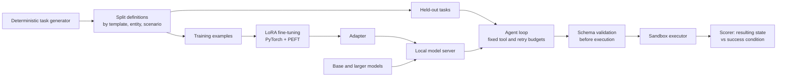

# Small model for accurate tool use

An experimental study: can a **small open-weight model (3–8B), fine-tuned with LoRA** on a narrow
tool-use task, approach a larger general model's success rate, at lower latency and memory? Success
is scored by **executing** the model's tool calls in a sandbox and checking the resulting state, not
by trusting what the model says it did.

> **Status (2026-10-23):** M1–M3 are complete. On test_unseen: base 7B 44%, 7B with an improved
> prompt 58%, base 14B 63%, 14B with the improved prompt 73% (`results/summary/m3.md`). M4's two
> LoRA pilots are done: the first exposed an answer leak in the gold trajectories, and the second
> (runbook trajectories, no leak) scored 57% on val (`results/summary/m4-pilot.md`). **M5: with
> 1,240 runbook trajectories the tuned 7B scores 84% on test_unseen**, ahead of the 14B with the
> improved prompt (73%, p = 0.0076), with no general-capability regression
> (`results/summary/m5-analysis.md`). One seed so far. The gain is tied to the trained tool
> interface: in project 02's live harness, with its own tools, the tuned model scored 12/30 vs the
> base model's 16/30 (`results/summary/m5-transfer.md`). Detail: [docs/README.md#status](docs/README.md#status).

## Research question

On sandbox service-diagnostics tasks, how close does a LoRA-tuned 3–8B model get to:

- (a) the same model with improved prompting, and
- (b) a larger general model,

measured by task completion verified from the resulting state? And at what latency and memory cost?

## Milestone 1: tasks, sandbox and scorer

**Tools (11):** five read tools (`service_status`, `get_metrics`, `search_logs`, `config_history`,
`deploy_history`), five actions (`restart_service`, `scale_service`, `rollback_config`,
`rollback_release`, `cleanup_spool`) and `finish(outcome, message)`. All have strict JSON Schemas
taken from project 02; an invalid call never executes and costs one of 3 retries. There is
deliberately no tool to rotate a credential: an expired credential tests whether the model
escalates instead of improvising.

**Tasks:** 22 kinds, 31 with their state-dependent variants, each combinable with 6 distractors
(unrelated config change, recent good deploy, old errors in logs, client-error noise, spool near
quota, none): 186 scenarios.

| | Kinds |
| --- | --- |
| Incidents (an alert; diagnose and fix) | crashed or hung worker, bad DB config (latest change, or buried under a later one), connection leak, queue backlog, full spool, bad deploy, slow payments provider, expired credential, client-error false alarm |
| Requests (an operator asks) | restart an instance / service, "restart the worker" (one vs several), restart the failed one, scale to N / already N / no N given, "if hung, restart", "if over quota, clean", clean up, roll back release, undo X's config change (latest or not), asks no tool can do |

Outcomes required: `resolved`, `no_action_needed`, `escalated` or `need_information`. Every task
has a correct non-action answer somewhere in the mix: 39% of catalogue tasks must change nothing.

**Scoring is from state, never from the model's message.** A task succeeds only if the `finish`
outcome is right, every effect the sandbox performed is allowed for that task, nothing changed when
nothing should, the sandbox's own health check passes when a fix is expected, and required state
holds (replica count, release, which instance was restarted, ...).

**Results** (930 tasks = 186 scenarios x 5 seeds; [m1.md](results/summary/m1.md)):

| Policy | Success |
| --- | --- |
| Reference trajectories (written from each task's setup) | 100% |
| Hand-written runbook (sees only tool output, plus what a request asks) | 100% |
| Best trivial strategy (always `finish: escalated`) | 16.1% |
| Restart all workers, claim resolved | 7.2% |
| Always `finish: resolved` | 0% |

The runbook result shows every task can be solved from what the tools return. It was written from
the catalogue, so it is an upper bound, not a realistic baseline. The trivial strategies set the
floor a model has to beat.

**Scorer tests** (2,453 in `tests/test_scorer.py`): the reference passes every scenario, and these plausible-looking wrong
trajectories fail in every scenario where they apply: wrong outcome, claiming success without
acting, one extra unneeded action, restarting the wrong worker, the wrong action. Disabling any of
the scorer's checks makes at least one test fail (mutation check, including a test for a sandbox
bug that changes state without recording it).

**Simulated sandbox (deviation from the plan).** Tasks run against a deterministic in-process
model of 02's sandbox, not its live processes. Live episodes take 10–200 s and their timing noise
makes repeat runs disagree; this study needs thousands of training trajectories and hundreds of
held-out episodes per condition and seed. The cost is realism, so M5 adds a transfer check on 02's
30 live incidents, comparable with 02's 15/30.

## Milestone 2: leak-resistant splits

Split definitions were frozen **before any task was generated** (`tasks/splits/splits.json`).
Three factors are held out: 2 of the 8 phrasing frames in every family, about 30% of every entity
pool, and one distractor per kind-variant. Details: [dataset card](docs/03-dataset-card.md).

| Set | Held out | Tasks | Same prompt + actions as a train task | Prompt-lookup ceiling |
| --- | --- | --- | --- | --- |
| train | none | 3,100 | n/a | n/a |
| val / test_seen | none | 155 each | 82% / 86% | 37% / 38% |
| test_template | phrasing | 155 | 0% | 0% |
| test_entity | names, versions, errors | 155 | 65% | 29% |
| test_scenario | noise combination | 155 | 85% | 40% |
| **test_unseen** | **all three** | 155 | **0%** | **0%** |

The prompt-lookup ceiling is what answering by exact-prompt lookup in train, without calling any
tool, would score. On the seen-template sets it's up to 40%, so gains there can be memorisation.
**test_unseen is the primary result.** No held-out template, entity or scenario combination occurs in
train (`tests/test_splits.py`, mutation-checked: each kind of leak makes it fail). The sets rebuild
byte for byte (hashes in `results/summary/m2_manifest.json`). Full audit:
[m2_audit.md](results/summary/m2_audit.md).

## Planned architecture



More detail: [docs/01-architecture.md](docs/01-architecture.md).

## Quick start

```bash
uv sync
uv run pytest                                   # 2,476 tests: validation, scorer, wrong trajectories, split overlap, SFT answer leak
uv run python -m eval.m1                        # reference / runbook / trivial policies -> results/summary/m1.*
uv run python -m tasks.splits.build             # train / val / test sets -> data/ (from the frozen splits)
uv run python -m eval.m2_audit                  # overlap audit -> results/summary/m2_audit.*
uv run python -m tasks.generator.generate --catalog .run/catalog.jsonl   # one task per scenario
```

## What is reused

| From | What |
| --- | --- |
| `02-reliable-operations-agent` | Tool names, scopes and schemas; incident kinds and action semantics (modelled in `executor/sandbox.py`); its 30 live incidents for the M5 transfer check |
| `01-llm-inference-lab` | The pinned llama.cpp build (b11439) and its converter, used to serve every condition, and a benchmark harness for latency and memory |

## Planned evaluation

- **Metrics:** task completion verified from state, tool-selection accuracy, argument validity, unnecessary or unauthorized calls, retries, latency, peak memory.
- **Hard cases:** unfamiliar templates, unavailable tools, ambiguous requests, no-action and missing-information tasks, all scored explicitly.
- **Comparisons:** base model vs improved prompting vs LoRA vs a larger model, with identical tools and budgets.
- **Ablations:** at least one, varying a single factor: data quantity, data quality or adapter rank.
- **Generalisation check:** a small general-capability set, to catch regressions from specialisation.
- **Leakage guards:** splits are fixed before generation; near-duplicate audit; adapter reload must reproduce the evaluated scores.

## Milestones

See [PLAN.md](PLAN.md): task definition → leak-resistant splits → baselines → pilot fine-tune → full
comparison → ablations. Brief: [SPEC.md](SPEC.md).

## Docs

The design record is in [docs/](docs/README.md), written to be read in order. **Current status, with
results through M4, is in [docs/README.md § Status](docs/README.md#status)**; the status note at the
top of this README dates from M2.

| # | Doc | What it settles |
| --- | --- | --- |
| 00 | [Charter](docs/00-charter.md) | The question, scope, non-goals, success criteria |
| 01 | [Architecture](docs/01-architecture.md) | The pipeline, its three rules, components, layout |
| 02 | [Tasks and scoring](docs/02-tasks-and-scoring.md) | Tools, simulated sandbox, task kinds, state-based scorer |
| 03 | [Dataset card](docs/03-dataset-card.md) | Generation, leak-resistant splits, overlap audit, weaknesses |
| 04 | [Fine-tuning](docs/04-fine-tuning.md) | Training data, LoRA setup, export, reload check, the two pilots |
| 05 | [Evaluation](docs/05-evaluation.md) | Conditions, metrics, statistics, results so far |
| 06 | [Roadmap](docs/06-roadmap.md) | Milestones, acceptance criteria, what is next |
| 07 | [Risks](docs/07-risks.md) | Thesis and delivery risks, claim hygiene |
| 08 | [Learning checklist](docs/08-learning-checklist.md) | Skills per milestone, interview talking points |
| 09 | [Implementation notes](docs/09-implementation-notes.md) | Where the build departs from the plan, and why |

To run things: [start.md](start.md) (CPU only) and [RUNBOOK.md](RUNBOOK.md) (GPU steps).

## What still needs the GPU

Baselines, fine-tuning and evaluation (M3–M6) need a model server and GPU time. The llama.cpp
stopgap from project 01 serves Qwen2.5-7B now and can run M3's baselines. Fine-tuning needs the 01
server stopped first, and latency/memory numbers need quiet GPU time: other users' jobs have swung
throughput from about 5.5 to about 42 tokens/s.

## Repository layout

```text
tasks/tools.py        the frozen tool set and schema validation
tasks/generator/      entity pools and templates (vocab), scenarios + reference trajectories, generator
tasks/splits/         frozen split definitions (splits.json), set builder
executor/             sandbox model, episode runner (budgets, validation), state-based scorer
baselines/runbook.py  hand-written observation-only policy
eval/                 M1 check, M2 overlap audit
tests/                validation, scorer and split-overlap tests
docs/                 architecture, dataset card
results/summary/      generated results
```
