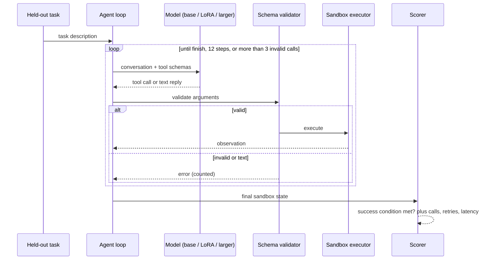

# 01 — Architecture

> Built: generator, splits, validator, sandbox, scorer, agent loop, runbook, LLM policy, evaluation
> and summary scripts, training-data builder, LoRA training and export. Not built yet: the
> controlled latency/memory benchmark and the general-capability set. Current state:
> [Status](README.md#status).

## The pipeline

```text
 tasks/generator/  ──►  tasks/splits/splits.json  ──►  tasks/splits/build.py  ──►  data/<set>.jsonl
 (kind × variant ×       (frozen BEFORE any task        (per-set allowed           train 3,100
  distractor ×            exists: held-out templates,     templates, entities,      val + 5 tests × 155
  template × seed)        entities, scenarios)            distractors)
                                                                 │
             ┌───────────────────────────────────────────────────┴──────────────────┐
             ▼ train only                                                            ▼ held-out sets
 train/build_sft.py  (gold or runbook trajectory,                    eval/run_model.py (one condition)
   executed through the real runner, rendered with                          │
   the model's own chat template)                                           ▼
             │                                          ┌──────────────────────────────────────┐
             ▼                                          │ executor/runner.py   agent loop      │
 train/sft.py  (LoRA, loss on assistant turns only)     │   12 steps, 3 retries, same for all  │
             │                                          │      │                               │
             ▼                                          │      ▼ tasks/tools.py  validate_call │
 train/export.py  (merge → f16 GGUF → Q4_K_M,           │      │  invalid: never runs, costs   │
   SHA-256 recorded)                                    │      │  a retry                      │
             │                                          │      ▼ executor/sandbox.py  World    │
             ▼                                          │        observation + recorded effect │
 env/models.sh serve  ──► llama.cpp (4 slots) ◄─────────┤  baselines/llm.py  LLMPolicy         │
   same build and flags for 7B, 14B and LoRA            └──────────────────┬───────────────────┘
                                                                           ▼
                                                        executor/scorer.py  (state, effects; never
                                                          the model's message)
                                                                           ▼
                                                        results/raw/*.jsonl ──► eval/summarize.py
                                                                                (Wilson CI, McNemar)
```

The three rules that make this design worth writing down:

**Rule 1: the score comes from state, never from the model's words.** The only thing the scorer
takes from `finish` is the outcome category. Everything else (which effects happened, whether
anything changed, whether the sandbox's own health check passes, replica count, release, which
instance restarted) is read from the sandbox. Reason: a model's report of what it did is the one
thing a tool-use evaluation can't trust, and an LLM judge reading transcripts would bring that trust
back in. Details in [02](02-tasks-and-scoring.md).

**Rule 2: only the model changes between conditions.** Same runner, tools, schemas, budget (12 steps,
3 retries), sampling (temperature 0, seed 0, 512 output tokens), llama.cpp build, quantisation
(Q4_K_M) and context per slot (8192) for every condition. The system prompt is the one variable in
the prompting conditions; the weights are the one variable in the LoRA conditions. Each raw file's
first line records model file, prompt hash, splits hash, budget and sampling
(`eval/run_model.py`), so a comparison can be checked rather than assumed.

**Rule 3: nothing is split after it is generated.** Split definitions are fixed first and the
generator is only ever called with a set's allowed inputs. Leakage is then a property of the inputs,
which a test can check exhaustively (`tests/test_splits.py`), rather than a property of generated
text, which can only be estimated. The same idea applies to training targets: a trajectory may only
depend on what the tools returned (`tests/test_sft_policy.py`, [04](04-fine-tuning.md)).

## Components

| Component | Responsibility | Where | Notes |
| --- | --- | --- | --- |
| Task generator | Produce tasks from templates × entities × scenarios with a machine-checkable success condition | `tasks/generator/` | Deterministic and seeded; no teacher model needed |
| Split definitions | Assign templates, entities and scenarios to train / val / held-out **before** any example exists | `tasks/splits/splits.json`, `make_splits.py` | Prevents near-duplicate leakage; refuses to be regenerated |
| Set builder | Build each set from its allowed factors; drop exact duplicates across sets | `tasks/splits/build.py` | Rebuilds byte for byte; hashes in `results/summary/m2_manifest.json` |
| Training data builder | Turn training tasks into chat transcripts with correct tool calls | `train/build_sft.py` | Provenance per example (task id, kind, variant); gold or runbook trajectories; manifest with data hash per build |
| Fine-tuning | LoRA via PyTorch + PEFT on a 3–8B base (Qwen2.5-7B-Instruct) | `train/sft.py` | Pilot run first to measure peak memory (19.7 GiB) |
| Export | Merge adapter, convert and quantise with project 01's llama.cpp | `train/export.py` | Records adapter, merged and GGUF SHA-256 |
| Model server | Serves base, LoRA and larger model with identical flags | `env/models.sh` (14B, LoRA); project 01 (base 7B) | llama.cpp b11439, Q4_K_M, `--parallel 4`, `--jinja`. Larger model loaded sequentially if memory is tight (14B runs were paused twice for memory, PLAN.md) |
| Agent loop | Same loop for every model: fixed tool budget, retry budget, max steps | `executor/runner.py` | Only the model and system prompt change between conditions |
| LLM policy | One OpenAI-compatible chat call per step, tools offered natively | `baselines/llm.py` | Transport errors retried without costing a policy retry |
| Validator | JSON-Schema validation of every call before execution | `tasks/tools.py` | Derived from 02's schemas; invalid calls never execute |
| Executor + scorer | Run calls in the sandbox; compare resulting state to the success condition | `executor/sandbox.py`, `executor/scorer.py` | A model's claim of success is never scored |
| Runbook | Hand-written observation-only policy | `baselines/runbook.py` | Solvability proof (930/930), and the M4+ training-trajectory source |
| Summaries | Per condition and set: success with 95% CI, per-family, failed checks; paired McNemar | `eval/summarize.py` | Never filters episodes: budget or transport failures count as failures |

## Data flow for one episode



A text reply with no tool call is an invalid reply and costs a retry, like a schema violation. Only
`finish` ends an episode as finished; running out of steps or retries is a failure
(`executor/runner.py`).

## Decisions open at design time, and how they closed

The original design doc listed three decisions to make before building. All three are closed:

| Decision | Outcome | Where |
| --- | --- | --- |
| Base model: supported by the serving recipe and licensed for this use | Qwen2.5-7B-Instruct (rev a09a354) tuned; Qwen2.5-14B-Instruct (rev cf98f3b, Apache-2.0) as the larger model. The 7B is Apache-2.0 too (the snapshot's `LICENSE`; [10](10-adapter-card.md)) | `train/build_sft.py`, `env/models.sh`, PLAN.md |
| Sequence length and batch size, from the pilot's measured peak memory | Batch 1 with 8-step gradient accumulation, whole trajectories (no truncation); pilot peak 19.7 GiB allocated | `train/sft.py`, `results/summary/m4-pilot.md` |
| Whether quantised training is supported on this hardware/software | Not attempted: LoRA on a bf16 base. Quantisation happens only at export, identically for every condition | `train/sft.py`, `train/export.py` |

## Repo layout

```text
04-small-model-tool-use/
├── SPEC.md  PLAN.md  README.md  start.md  RUNBOOK.md
├── pyproject.toml  uv.lock        # jsonschema, httpx; pytest (dev). Training deps: train/ENVIRONMENT.md
├── tasks/
│   ├── tools.py                   # the frozen tool set and schema validation
│   ├── generator/                 # vocab.py (entity pools, templates), scenarios.py (kinds, gold), generate.py
│   └── splits/                    # splits.json (frozen), make_splits.py, build.py
├── executor/                      # sandbox.py (World), runner.py (agent loop, budgets), scorer.py
├── baselines/                     # runbook.py, llm.py (LLM policy), prompts.py (base, improved, improved-v2)
├── train/                         # build_sft.py, sft.py, export.py, ENVIRONMENT.md
├── eval/                          # m1.py, m2_audit.py, run_model.py, summarize.py
├── env/                           # models.sh (build/serve), mem_guard.sh, run_guarded.sh
├── tests/                         # validation, scorer, split overlap, SFT trajectory leak
├── results/
│   ├── raw/                       # one JSONL per (condition, set) run; partial/ and smoke/ are not results
│   └── summary/                   # m1, m2_audit, m2_manifest, m3, m3-val-analysis, m4-pilot
└── docs/                          # you are here
# git-ignored: data/ (rebuildable), models/ (GGUFs), .run/ (SFT data, adapters, logs), .venv/, train/.venv/
```

Two layout decisions worth defending:

- **`data/` is not committed; its hashes are.** `python -m tasks.splits.build` regenerates every set
  byte for byte from `splits.json`, and `results/summary/m2_manifest.json` holds the SHA-256 of each
  file. Committing the hashes instead of 4,030 tasks keeps the repo small and makes "same data" a
  check, not a promise.
- **Two Python environments.** The scoring and evaluation code needs only `jsonschema` and `httpx`
  (`pyproject.toml`), so tests run anywhere on CPU. Training uses `train/.venv`, which reuses the
  host's NVIDIA PyTorch build and adds PEFT without dependencies, so pip can't replace the CUDA torch
  (`train/ENVIRONMENT.md`).
