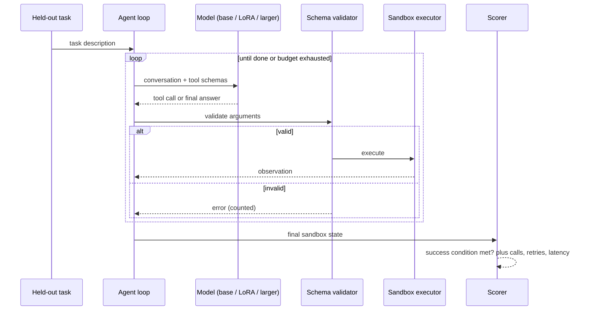

# Planned architecture

> M1 components (generator, validator, executor + scorer, agent loop) are built; see README. Model serving, fine-tuning and the data builder are still design.

## Components

| Component | Responsibility | Notes |
| --- | --- | --- |
| Task generator | Produce tasks from templates × entities × scenarios with a machine-checkable success condition | Deterministic and seeded; no teacher model needed |
| Split definitions | Assign templates, entities and scenarios to train / val / held-out **before** any example exists | Prevents near-duplicate leakage |
| Training data builder | Turn training tasks into chat transcripts with correct tool calls | Provenance recorded per example |
| Fine-tuning | LoRA via PyTorch + PEFT on a 3–8B base | Pilot run first to measure peak memory |
| Model server | Serves base, adapter and larger model via the 01 gateway | Larger model loaded sequentially if memory is tight |
| Agent loop | Same loop for every model: fixed tool budget, retry budget, max steps | Only the model changes between conditions |
| Validator | JSON-schema validation of every call before execution | Reuses 02's schemas; invalid calls never execute |
| Executor + scorer | Run calls in the sandbox; compare resulting state to the success condition | A model's claim of success is never scored |

## Data flow

## Decisions to make before building

- Base model: must be supported by the serving recipe and licensed for this use.
- Sequence length and batch size: from the pilot run's measured peak memory.
- Whether quantised training is supported on the exact hardware and software.
